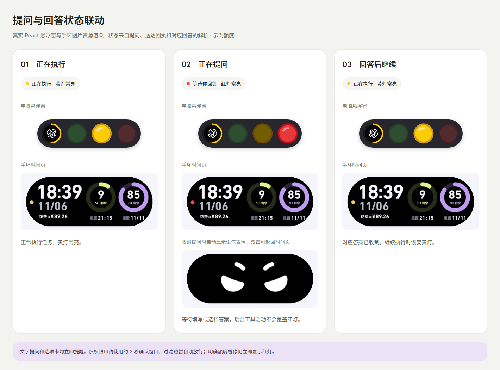
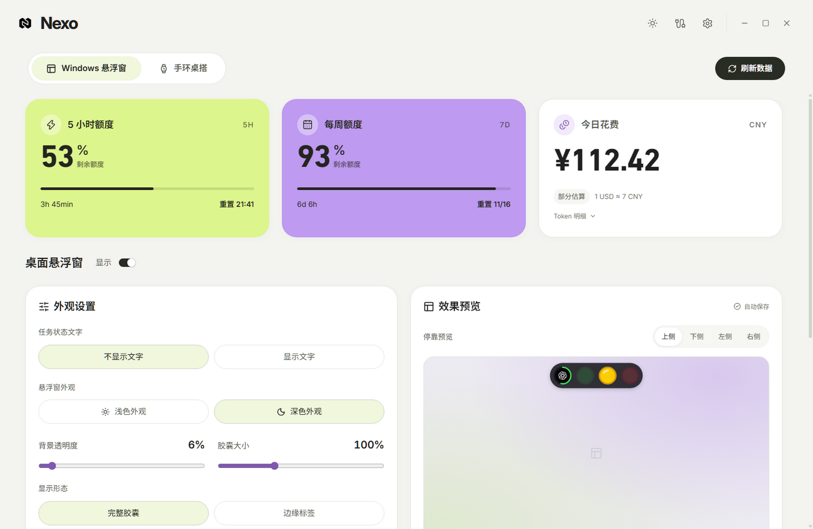
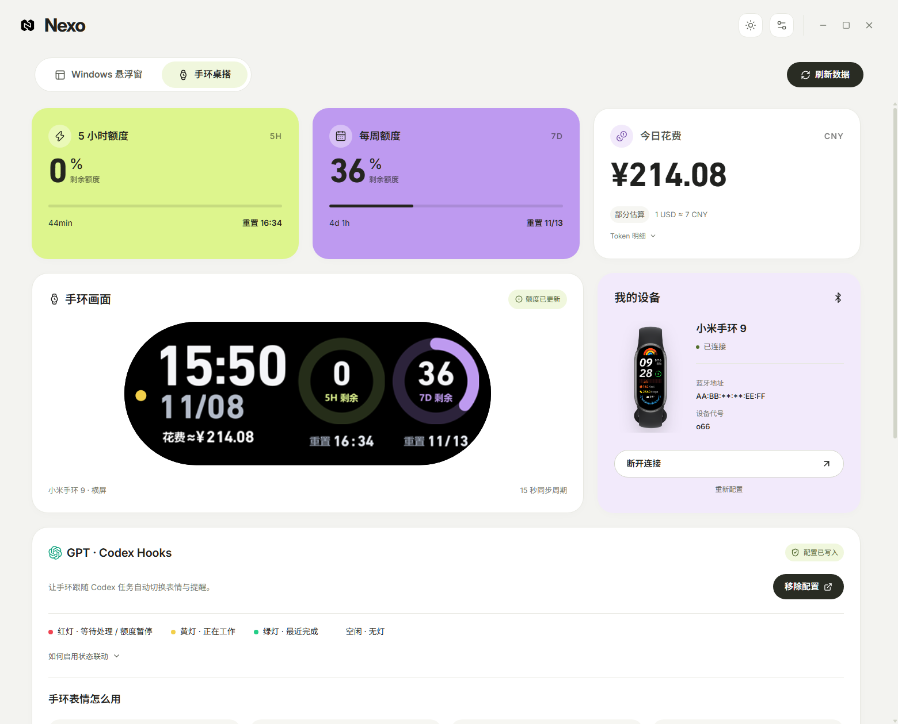

  <picture>
    <source media="(prefers-color-scheme: dark)" srcset="docs/images/nexo-logo-dark.svg" />
    
  </picture>
  <h1>Nexo</h1>
  
通过 Windows 桌面悬浮窗或小米手环桌搭，查看 ChatGPT/Codex 额度与任务状态。

  <a href="#使用说明">使用说明</a> ·
  <a href="#版本更新">版本更新</a> ·
  <a href="docs/BUILDING.md">源码构建</a> ·
  <a href="https://github.com/awesome-sean/Nexo/issues">反馈问题</a>

- **Windows 桌面悬浮窗**。下载并安装电脑端 EXE 即可使用。 
  最新 EXE 下载地址　[https://github.com/awesome-sean/Nexo/releases/download/v1.0.4/Nexo-Setup-1.0.4.exe](https://github.com/awesome-sean/Nexo/releases/download/v1.0.4/Nexo-Setup-1.0.4.exe)
- **小米手环横屏桌搭**。需要电脑端 EXE 和手环 RPK，连接后联动使用。 
  最新 RPK 下载地址　[https://github.com/awesome-sean/Nexo/releases/download/v1.0.2/Nexo-Band-1.0.2.rpk](https://github.com/awesome-sean/Nexo/releases/download/v1.0.2/Nexo-Band-1.0.2.rpk)

## 版本更新

| 应用 | 当前版本 | 发行页 |
| --- | --- | --- |
| 电脑应用程序 · Windows | **v1.0.4** | [电脑端 v1.0.4 发行页](https://github.com/awesome-sean/Nexo/releases/tag/v1.0.4) |
| 手环快应用 · 小米手环 | **v1.0.2** | [手环快应用 v1.0.2 发行页](https://github.com/awesome-sean/Nexo/releases/tag/v1.0.2) |

[查看所有版本](https://github.com/awesome-sean/Nexo/releases)

## 主要功能

### 电脑端应用程序

- **额度一览**：同时查看 5 小时和每周剩余额度及重置时间。
- **花费估算**：按当天 Token 用量和可调整汇率，估算人民币花费；金额仅供参考。
- **设备管理**：通过 AstroBox 或手机日志导入手环资料，连接后管理和升级快应用。
- **后台与更新**：支持开机自启动、托盘运行、连接诊断和应用内检查更新。

### 桌面悬浮窗

- **任务状态灯**：用红、黄、绿灯显示 Codex 的等待、执行与完成状态；多个任务优先提示需要处理的事项。
- **额度详情**：GPT 图标圆环显示 5 小时额度，鼠标悬停可查看 5 小时和每周额度；双击将 ChatGPT 窗口切到前台。
- **个性化外观**：调整深浅外观、状态文字、透明度、大小和详情字体颜色。
- **四向停靠**：悬浮窗可停靠桌面四边，调整边距；收起为边缘标签后可悬停展开。

### 小米手环横屏桌搭

- **常亮桌搭**：快应用在前台运行时保持常亮，横屏展示时间、额度、重置时间与当天花费。
- **状态联动**：手环状态灯、表情与电脑端任务状态同步，等待处理和任务完成时可振动提醒。
- **快捷操作**：双击切换时间页与表情页，连续右滑两次退出；振动提醒可在电脑端关闭。

## 任务状态一眼看懂

| 灯色 | 什么时候亮 | 手环提醒 |
| --- | --- | --- |
| 🔴 等待处理 | Codex 提问、等待审核，或额度不足暂停 | 自动显示 生气，短振＋长振重复六组 |
| 🟡 正在执行 | Codex 正在工作，收到对应回答后继续执行 | wink，无振动 |
| 🟢 最近完成 | 任务完成，保留 10 分钟 | 自动显示 星星眼，连续四次长振 |
| 熄灯 | 当前空闲 | 睡觉，无振动 |

提问后保持红灯，收到对应回答才恢复黄灯。多个任务优先显示待处理的红灯，其次为执行中的黄灯。只要还有任务执行就保持黄灯，全部完成后亮绿灯，完成提示保留十分钟。

## 界面预览

以下为当前源码实际渲染，额度与设备信息使用示例数据，图片保持原始比例。

## 使用说明

### 安装并启动 Nexo

1. 下载并安装 [电脑端 EXE v1.0.4](https://github.com/awesome-sean/Nexo/releases/download/v1.0.4/Nexo-Setup-1.0.4.exe)。
2. 打开 Nexo，并在电脑上登录 ChatGPT。

### 开启任务状态联动（共用）

桌面悬浮窗和手环桌搭都使用同一套 Codex Hooks；只查看额度时，可先跳过此步骤。

1. 打开 Nexo，点击右上角「连接必备」。
2. 找到「GPT · Codex Hooks」，点击「配置 Hooks」。
3. 在 Codex 中审核并信任 Nexo 状态灯命令。Codex CLI 可运行 `/hooks`，桌面端按 Hooks 审核提示操作。
4. 重新开始 Codex 会话，并保持 Nexo 在后台运行。

更多配置方法和命令请查看 [命令行与进阶说明](NEXO-README.md)。

### Windows 桌面悬浮窗

1. 在 Nexo 选择「Windows 悬浮窗」，打开「桌面悬浮窗」标题旁的「显示」开关。
2. 按需调整深浅外观、任务文字、透明度、大小、停靠方向和边缘距离，设置会自动保存。右键悬浮窗也可调整常用设置。
3. 悬停 GPT 图标查看 5 小时与每周额度，移开收起详情；双击图标将 ChatGPT 窗口切到前台。启用边缘标签后，鼠标悬停标签可展开悬浮窗。

在「设置 → 偏好设置」或托盘右键菜单开启「开机自启动」后，Windows 登录时 Nexo 会在托盘运行；悬浮窗按已保存的显示开关决定是否出现。

### 小米手环桌搭

需要 [电脑端 EXE v1.0.4](https://github.com/awesome-sean/Nexo/releases/download/v1.0.4/Nexo-Setup-1.0.4.exe)、[手环 RPK v1.0.2](https://github.com/awesome-sean/Nexo/releases/download/v1.0.2/Nexo-Band-1.0.2.rpk) 和电脑蓝牙。

1. 用小米运动健康完成手环账号绑定；电脑开启蓝牙并登录 ChatGPT。
2. 在 Nexo「手环桌搭」点击「连接手环」，选择导入方式：
   - **AstroBox 导入**：在电脑版 AstroBox 登录同一小米账号并同步手环，再回到 Nexo 读取设备；如出现授权请求，批准后选择手环。导入完成后在 AstroBox 中断开手环。
   - **手机日志导入**：选择小米运动健康导出的日志，按向导提取并确认手环资料。
3. 按向导连接手环。手环出现确认请求时点击同意。
4. 通过向导或「手环快应用」卡片安装 Nexo 快应用。安装完成后会发送打开指令，保持 Nexo 在后台运行以同步数据。
5. 下次启动 Nexo 后，点击「连接手环」即可；已安装快应用时会自动发送打开指令，更新可在「手环快应用」卡片单独进行。

| 功能或状态 | 手环表现 |
| --- | --- |
| 屏幕常亮 | 快应用在前台运行时保持常亮 |
| 双击屏幕 | 切换时间页与表情页 |
| 连续右滑两次 | 退出快应用 |
| 等待处理 | 自动显示生气，振动六组「短振＋长振」 |
| 任务完成 | 自动显示星星眼，连续四次长振，10 分钟后返回时间页 |

等待处理时也可双击返回时间页；任务继续后会自动返回。振动可在「连接必备 → 手环提醒与表情」关闭，需电脑端与快应用使用配套版本。具体振动时长由手环决定。

**连接异常**：让手环靠近电脑并保持亮屏，暂停手机同步并断开 AstroBox 等其他连接，再重试；可在「设置 → 运行诊断」查看状态。退出 Nexo 或关闭电脑后同步停止，重新启动后需手动连接。

## 更新

**电脑端**：在「设置 → 关于 Nexo」检查更新，下载并校验后按 Windows 安装向导操作；失败时可选择浏览器下载。个人设置与绑定保存在本机。

**手环快应用**：保持手环连接，在「设置 → 关于 Nexo」覆盖升级，也可手动安装 RPK。

## 支持设备

Windows x64，需要电脑蓝牙。适配小米手环 **9 / 10 / 11 标准版和 NFC 版**。小米手环 9 标准版已实机确认，其他型号尚未实机检验。

## 费用与数据

花费按电脑本地日期统计 Token，结合模型价格和可调整汇率估算。日志缺失及未知模型会影响金额，请以服务方账单为准。手环绑定资料与 Codex 登录信息在本机使用，检查更新需要访问 GitHub。反馈时请遮盖密钥、令牌和完整蓝牙地址。

## 源码与许可

Electron、React、TypeScript、Rust 与 Xiaomi Vela。构建步骤见 [源码构建](docs/BUILDING.md)。

代码采用 [MIT License](LICENSE)。字体、标识、设备图片和表情素材的来源与授权范围见 [素材说明](NOTICE.md) 和 [第三方许可](assets/THIRD-PARTY-LICENSES.txt)。

如果 Nexo 对你有帮助，欢迎点击 GitHub 页面右上角的 ⭐ Star，或提交问题与改进建议。也可以在程序「设置 → 打赏作者」，支持持续维护与更新。每一份支持都很重要。
